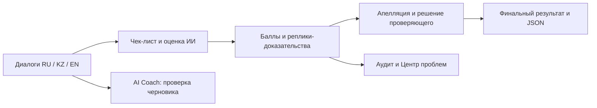
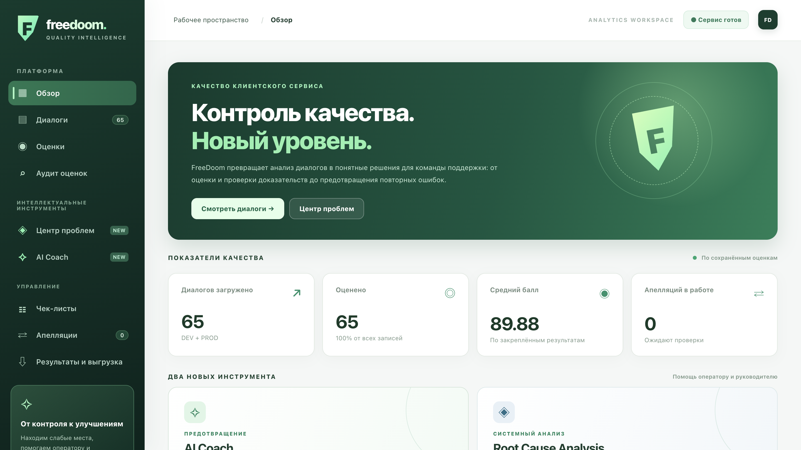
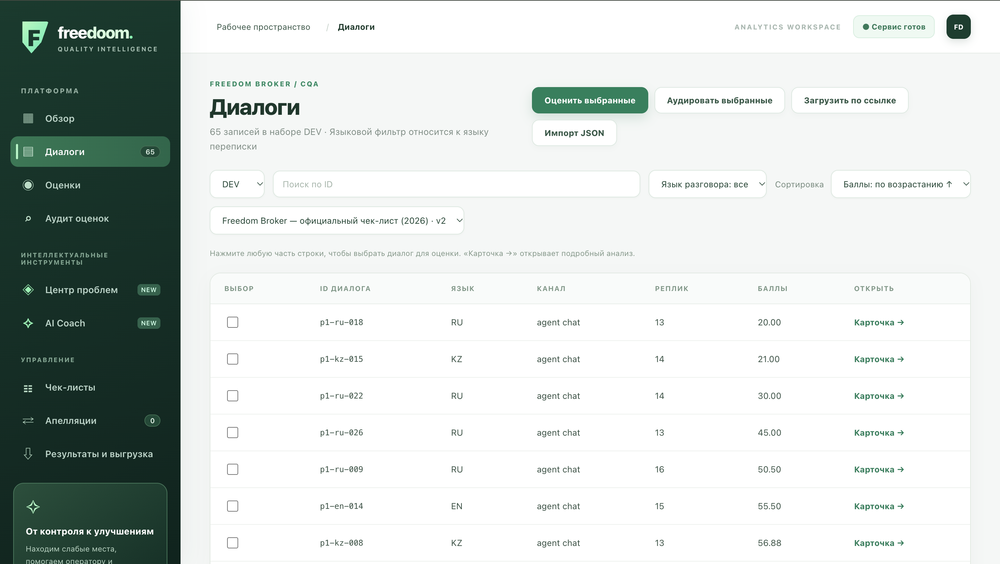
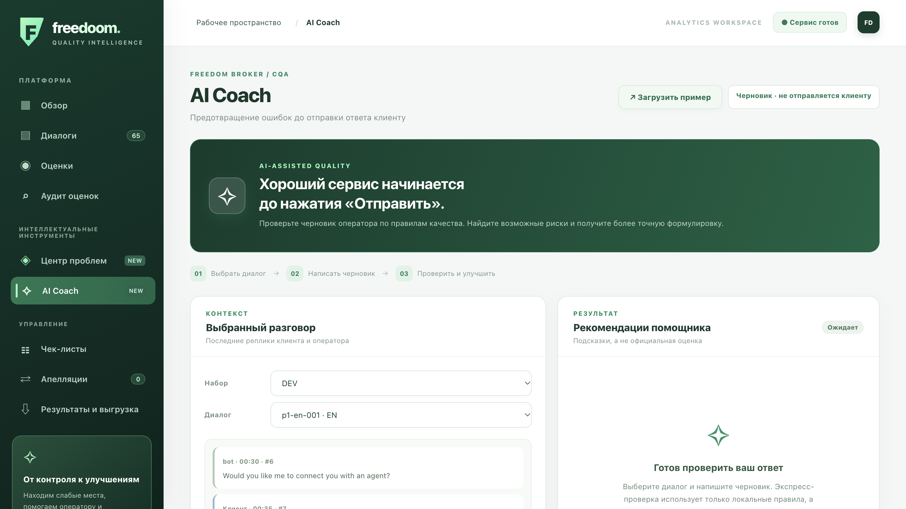
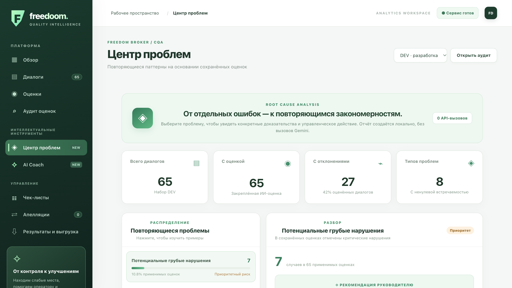

<div align="center">

# FreeDoom

### Conversation Quality Intelligence

**Freedom Broker · CQA Hackathon 2026**

*От оценки разговоров — к предотвращению ошибок и улучшению клиентского сервиса.*

[Быстрый запуск](#-быстрый-запуск) · [Возможности](#-что-умеет-freedoom) · [Демонстрация](#-сценарий-демонстрации) · [Результаты](#-результаты-для-организаторов)

</div>

---

## 🎯 О проекте

**FreeDoom** — прототип платформы контроля качества клиентских коммуникаций для **Freedom Broker**. Система анализирует переписки и транскрипты звонков, оценивает **работу человека-оператора** по настраиваемому чек-листу и показывает не только итоговый балл, но и причины оценки со ссылками на конкретные реплики.

**Проблема.** Ручная проверка диалогов требует времени; ошибочные или неполные консультации сложно замечать системно, а отдельные выводы ИИ могут быть спорными.

**Наш подход.** Объединить автоматическую оценку, прозрачные доказательства, человеческий пересмотр и инструменты предотвращения повторных ошибок в одном интерфейсе.

> **The idea:** FreeDoom turns conversation QA from a retrospective score into an explainable, reviewable and actionable quality-improvement workflow.

## ✨ Что умеет FreeDoom

| Обязательный контур CQA | Возможности |
|---|---|
| **Оценка диалогов** | RU / KZ / EN; чаты и готовые транскрипты звонков; оценка оператора по конфигурируемому чек-листу |
| **Объяснимость** | Значение, вес и баллы по критерию, краткое обоснование и ссылки на пронумерованные реплики |
| **Гибкий чек-лист** | Изменение критериев, весов, шкал и правил N/A через интерфейс; сохранение новой версии |
| **Апелляции** | Оспаривание отдельного критерия, просмотр доказательств, решение проверяющего и пересчёт итога |
| **Результаты** | Экспорт `results.json` по схеме организаторов 1.0 для DEV и PROD |

**Дополнительные инструменты команды:**

- **AI Coach** — проверяет черновик ответа *до отправки клиенту*. Есть локальная экспресс-проверка и опциональный анализ через Gemini с предлагаемой формулировкой. Ничего клиенту автоматически не отправляется.
- **Root Cause Analysis / Центр проблем** — группирует повторяющиеся слабые места в сохранённых оценках, показывает подтверждающие реплики и возможные действия для руководителя. Выводы о причинах — **гипотезы**, а не доказанные причинно-следственные связи.
- **Аудит оценок** — без дополнительных вызовов ИИ проверяет шкалы, N/A, ссылки на доказательства, арифметику и потенциальные противоречия обоснований.
- **История оценок** — сохраняет разные попытки анализа и позволяет явно выбрать основной результат; повторный запуск не заменяет его незаметно.

### Как устроен процесс



**Безопасность оценки:** при N/A неприменимый критерий исключается из расчёта, а веса остальных перераспределяются до 100 баллов. Грубые ошибки отмечаются отдельным флагом и не обнуляют результат автоматически. Сохраняются исходные номера реплик, включая сообщения клиента, бота и системы.

## 🧰 Технологии

| Слой | Реализация |
|---|---|
| Интерфейс | HTML, CSS, JavaScript без фронтенд-фреймворка |
| HTTP API | Python 3.9+, FastAPI, Uvicorn |
| Хранение | SQLite: диалоги, чек-листы, оценки, апелляции |
| ИИ-оценка | Google Gemini API; модель задаётся в `.env` |
| Подсчёт баллов | Детерминированная арифметика с перераспределением N/A |
| Проверка | Автоматические тесты `unittest` |

Архитектура интерфейса позволяет в дальнейшем адаптировать HTML-компоненты для интеграции с Dynamics 365. **Интеграция с Dynamics 365 в данном прототипе не реализована.**

## 🚀 Быстрый запуск

**Необходимы:** Git, Python **3.9+**, доступ к терминалу. Команды ниже предназначены для macOS/Linux. На Windows используйте эквиваленты PowerShell.

```bash
# 1. Скачать исходный код

git clone https://github.com/realadikaah/FreeDoom-CQA.git
cd FreeDoom-CQA

# 2. Подготовить окружение
python3 -m venv .venv
source .venv/bin/activate
python3 -m pip install -r requirements.txt

# 3. Создать локальный файл настроек
cp .env.example .env

# 4. Запустить приложение
python3 start.py
```

Откройте **http://127.0.0.1:8000**. HTTP API и его интерактивная документация доступны на **http://127.0.0.1:8000/docs**.

**Для новой настоящей ИИ-оценки** задайте в `.env` свой действующий `GEMINI_API_KEY` и доступную для него `GEMINI_MODEL`. Затем перезапустите сервер. **Ключ не требуется**, чтобы открыть интерфейс, редактировать чек-листы, просматривать уже импортированные результаты и пользоваться локальной экспресс-проверкой AI Coach.

```dotenv
GEMINI_API_KEY=YOUR_OWN_KEY
GEMINI_MODEL=gemini-3.5-flash-lite
ENSEMBLE=1
TEAM_NAME=FreeDoom
MOCK=0
```

> **Важно при клонировании из GitHub:** исходные `data/dev.json`, историческая SQLite-база и `.env` намеренно **не публикуются**. Поэтому после первого запуска на новом компьютере список диалогов будет пустым, пока вы не загрузите предоставленный организаторами набор. Публичный файл с результатами DEV находится отдельно в `results/dev/results.json`; он не является исходным набором транскриптов и сам по себе не восстанавливает карточки в SQLite.

## Интерфейс FreeDoom

### Главная панель


### Анализ диалога


### AI Coach


### Root Cause Analysis


## 📥 Загрузка и оценивание диалогов

1. Откройте **«Диалоги»** и выберите набор **DEV** или **PROD**.
2. Нажмите **«Импорт JSON»**, чтобы загрузить предоставленный организаторами файл, или **«Загрузить по ссылке»** для поддерживаемого HTTPS-адреса API организаторов.
3. Выберите чек-лист и диалоги, затем нажмите **«Оценить выбранные»**.
4. Перед новыми запросами к Gemini система показывает, что будет использовано из сохранённых результатов, а что потребует нового обращения к API.
5. Откройте **«Карточку»** для просмотра баллов и переходов к репликам. При необходимости подайте **апелляцию**, примите решение проверяющего и посмотрите пересчитанный итог.

Официальный формат входного JSON: объект с `data.records` либо массив диалогов. Для каждой записи необходимы `conversation_id`, `channel`, `language`, `transcript`, а внутри реплики — `timestamp`, `speaker`, `text`.

Новые оценки могут отличаться от старых, если меняются модель, чек-лист или параметры запуска. **Стабильность сохранённого результата не означает доказанную точность относительно эталона организаторов.**

## 📊 Результаты для организаторов

Формат выгрузки — **JSON schema 1.0**, без изменения идентификаторов диалогов и критериев.

```text
results/
├── dev/
│   └── results.json     # 65 DEV-диалогов
└── prod/
    └── results.json     # 10 контрольных чатов после их выдачи
```

- **DEV:** файл `results/dev/results.json` включён в репозиторий; в нём 65 результатов, по 8 критериев на диалог.
- **PROD:** после получения и обработки десяти контрольных чатов файл будет добавлен по точному пути `results/prod/results.json`. Данные не подменяются фиктивными ответами.
- В верхнем уровне JSON используются `schema_version`, `team_name`, `model`, `results`. Название команды — **FreeDoom**; название фактически использованной модели указано в `model.name`.
- Для каждого критерия передаются `criterion_id`, `value`, `rationale`, `evidence_turns`; для диалога — итоговый балл и флаг грубой ошибки. Ошибки обработки записываются явно, а не маскируются нулём.

В приложении откройте **«Результаты и выгрузка» → «Записать в results/dev»** или **«Записать в results/prod»**, затем проверьте JSON и выполните `git add`, `git commit`, `git push`. Приложение **не публикует файлы в GitHub автоматически**.

## 🎬 Сценарий демонстрации

| Этап | Что показать | Зачем это бизнесу |
|---|---|---|
| **1. Данные** | DEV/PROD, RU/KZ/EN, импорт диалогов | Масштабируемая единая обработка обращений |
| **2. Оценка** | Чек-лист, итог, N/A, реплики-доказательства | Прозрачный контроль качества |
| **3. Пересмотр** | Апелляция → решение проверяющего → новый итог | Человеческий контроль над выводами ИИ |
| **4. Аналитика** | Центр проблем и аудит сомнительных оценок | Приоритеты для обучения и улучшения процессов |
| **5. Предотвращение** | AI Coach: исходный черновик → предупреждение → улучшенный ответ | Меньше повторных ошибок в будущем |

**Ключевая идея:** FreeDoom помогает не только обнаруживать ошибки *после разговора*, но и предотвращать их *до следующего ответа*.

## 🔐 Ограничения и безопасность

- Прототип разработан для локальной демонстрации **без регистрации и авторизации**. Его нельзя публиковать с реальными клиентскими данными в открытом интернете без дополнительной защиты.
- `.env`, локальная SQLite-база и исходные DEV-транскрипты не должны попадать в публичный репозиторий без разрешения на публикацию.
- AI Coach — подсказка человеку, а не механизм автоматической отправки сообщений клиентам. Его рекомендации необходимо проверять по актуальным тарифам и регламентам компании.
- Аудит и Root Cause Analysis могут ошибаться; подтверждение нарушений и окончательное решение остаются за проверяющим.
- Для платной модели стоимость оценки зависит от фактических входных/выходных токенов, тарифа модели и количества повторов `ENSEMBLE`. При защите нужно сообщить приблизительную стоимость на основе реального использования и текущих тарифов API.

## 🧪 Тестирование

```bash
python3 -m unittest discover -s tests -v
```

Для проверки доступности моделей вашему ключу:

```bash
python3 list_models.py
```

## 👥 Команда FreeDoom

| Участник |
|---|
| **Tolegen Adilzhan** |
| **Rassul Sissenbay** |
| **Yerassyl Nassypkeliyev** |
| **Abay Tleugalyev** |

**Challenge:** Freedom Broker — Conversation Quality Analytics (CQA) Hackathon, 2026.

---

*FreeDoom — explain the score, review the evidence, prevent the next mistake.*
